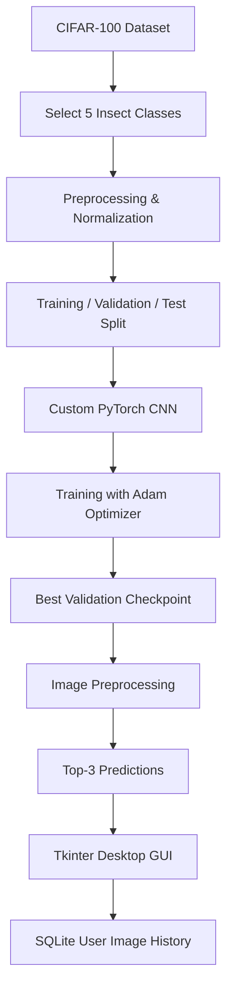

::: {align="center"}
# 🐞 INSECT CLASSIFIER

### Deep Learning • Computer Vision • Desktop Application

**Project 31 --- CNN-Based 5-Class Insect Image Classification**

Built with PyTorch, Tkinter & SQLite

`<br>`{=html}


**Muhammad Anas Murtaza**\
`DF2-AI-2026-031`
:::

------------------------------------------------------------------------

## 📌 Project Overview

**Insect Classifier** is a desktop-based image classification
application that uses a custom Convolutional Neural Network (CNN),
implemented with basic PyTorch layers, to classify insect images into
five categories.

The project combines a machine-learning pipeline with a user-friendly
Tkinter desktop interface and a per-user SQLite image history system.
Users can register, log in, select an image, inspect the model's top-3
predictions, optionally record the known true label, and save their
prediction history.

The CNN is built and trained from scratch. **No pretrained network or
transfer learning is used.**

## 🎯 Supported Insect Categories

The model uses this fixed output-class order:

    Output index Class
  -------------- ----------------
               0 🐝 Bee
               1 🪲 Beetle
               2 🦋 Butterfly
               3 🐛 Caterpillar
               4 🪳 Cockroach

**Input specification:** 32 × 32 pixels, RGB.

## ✨ Key Features

-   **Custom CNN:** A convolutional neural network built from basic
    PyTorch layers.
-   **Five-class prediction:** Recognizes bee, beetle, butterfly,
    caterpillar, and cockroach.
-   **Desktop GUI:** Image selection and prediction through a Tkinter
    application.
-   **Top-3 results:** Displays the three highest-scoring class
    predictions.
-   **User accounts:** Registration and login with password hashing.
-   **Personal image history:** Each user can view and manage their own
    saved records.
-   **Image preview:** Preview saved images from the history.
-   **History management:** Delete records and export history to CSV.
-   **True-label recording:** Optionally attach a known true label to a
    saved prediction.
-   **Reproducible training:** Fixed random seeds and a documented
    train/validation/test split.
-   **Evaluation outputs:** Training curves, confusion matrix, sample
    predictions, and error analysis.
-   **PDF report:** Generate a six-page report from available project
    artifacts.

## 🧠 Model & Training Pipeline

The classifier follows a conventional image-classification workflow:



### Dataset

The project uses a selected five-class subset of the CIFAR-100 dataset.

  Dataset property                 Specification
  -------------------------------- ------------------
  Source                           CIFAR-100
  Selected categories              5 insect classes
  Training images per class        500
  Official test images per class   100
  Training subset                  2,500 images
  Official test subset             500 images
  Image dimensions                 32 × 32
  Color channels                   RGB
  Random seed                      42

The training subset is split into:

  Split              Images Purpose
  ---------------- -------- ------------------------------
  Fit / training      2,000 Learn model parameters
  Validation            500 Select the best checkpoint
  Official test         500 Monitor final generalization

Class selection is performed using CIFAR-100 fine-class **names**,
rather than relying on hard-coded class IDs.

### Training Configuration

  Parameter              Value
  ---------------------- --------------------------
  Framework              PyTorch
  Model                  Custom CNN
  Optimizer              Adam
  Learning rate          0.001
  Weight decay           0.0001
  Batch size             64
  Default epochs         30
  Random seed            42
  Checkpoint selection   Best validation accuracy
  Pretrained model       Not used
  Transfer learning      Not used

The best validation-accuracy checkpoint is saved at:

``` text
models/insect_cnn.pt
```

The official test set is used for monitoring and evaluation, not for
selecting the checkpoint or tuning hyperparameters.

> Exact floating-point results may vary across hardware, operating
> systems, and device configurations.

## 🖥️ Desktop Application

The application is a **native desktop program**, not a localhost
website.

### Application Workflow

1.  Register a new account using a username and password.
2.  Log in with your credentials.
3.  Select an image from your computer.
4.  View the model's top-3 predicted insect classes.
5.  Optionally select the known true label.
6.  Save the prediction to your personal history.
7.  Preview or delete saved records.
8.  Export your history as a CSV file.
9.  Log out to clear the active session.

```{=html}
<details>
```
```{=html}
<summary>
```
`<b>`{=html}Application capabilities`</b>`{=html}
```{=html}
</summary>
```
-   Username registration and login
-   Image selection and prediction
-   Top-3 prediction display
-   Optional true-label entry
-   Per-user saved image history
-   Image preview
-   Record deletion
-   CSV export
-   Session logout

```{=html}
</details>
```
**Note:** No model training takes place when the GUI starts. The
application loads the available trained checkpoint for inference.

## ⚙️ Installation & Setup

### System Requirements

-   Windows 10 / 11
-   Python 3.11 or 3.12
-   Tkinter support
-   Visual Studio Code (recommended)
-   Internet connection for initial package and dataset downloads

### 1. Clone the Repository

``` bash
git clone https://github.com/anasmurtaza/Insect-Classifier.git
cd Insect-Classifier
```

### 2. Create a Virtual Environment

``` bat
py -3 -m venv .venv
```

### 3. Install Dependencies

``` bat
.venv\Scripts\python.exe -m pip install -r requirements.txt
```

### 4. Launch the Application

``` bat
.venv\Scripts\python.exe app.py
```

Alternatively, double-click:

``` text
start_windows.bat
```

### 5. Configure VS Code

1.  Open the extracted project folder in VS Code.
2.  Open the Command Palette using `Ctrl + Shift + P`.
3.  Select **Python: Select Interpreter**.
4.  Choose `.venv\Scripts\python.exe`.
5.  Use the included F5 configurations to debug the application.

## 🏋️ Training the CNN

To train the model using the default 30 epochs:

``` bat
.venv\Scripts\python.exe train.py --epochs 30
```

The CIFAR-100 dataset is downloaded automatically into the `dataset/`
directory. The full archive is required before filtering the five
selected categories. The archive is approximately 169 MB.

To use an existing torchvision-compatible dataset directory:

``` bat
.venv\Scripts\python.exe train.py --data-root PATH
```

To run a quick code smoke test:

``` bat
.venv\Scripts\python.exe train.py --epochs 1
```

A one-epoch run is only a smoke test, not a meaningful final training
experiment.

### Device Selection

CPU:

``` bat
.venv\Scripts\python.exe train.py --device cpu
```

CUDA:

``` bat
.venv\Scripts\python.exe train.py --device cuda
```

Use CUDA only when a compatible NVIDIA GPU and PyTorch CUDA environment
are available.

**Important:** Retraining overwrites the model and generated results.
Close and reopen the desktop application after retraining to load the
newly trained checkpoint.

## 📊 Model Evaluation & Outputs

Training generates the following evaluation artifacts:

  Output file                Description
  -------------------------- --------------------------------------------
  `history.csv`              Epoch-wise training and validation history
  `metrics.json`             Evaluation metrics in JSON format
  `curves.png`               Training and validation curves
  `confusion_matrix.png`     Class-wise confusion matrix
  `samples.png`              Example prediction samples
  `wrong_predictions.png`    Visualized incorrect predictions
  `wrong_predictions.json`   Details of incorrect predictions

Actual model results should be taken from the generated evaluation
files. No accuracy or performance figure is assumed in this README.

### Evaluation Metrics

The project reports:

-   Training loss and accuracy
-   Validation loss and accuracy
-   Test loss and accuracy
-   Confusion matrix
-   Incorrect prediction examples

## 📄 PDF Project Report

The project includes a six-page `report.pdf`.

The report generator reads the available `outputs/metrics.json`,
training curves, error examples, and GUI screenshots.

Regenerate the report using:

``` bat
.venv\Scripts\python.exe build_report.py
```

For updated GUI evidence, capture the following screenshots from the
running application:

``` text
outputs/gui_login.png
outputs/gui_predict.png
outputs/gui_history.png
```

The report generator identifies missing evidence instead of inventing
screenshots or results.

## 🧪 Run Unit Tests

Execute the test suite:

``` bat
.venv\Scripts\python.exe -m unittest discover -s tests -v
```

The tests cover:

-   Password hashing and login
-   Duplicate username handling
-   SQL injection input handling
-   Owner-only history access and deletion
-   Copied image deletion
-   Permitted CNN model layers
-   Model logits shape
-   Backward-pass functionality
-   Checkpoint loading
-   Prediction probability output

## 📁 Project Structure

``` text
Insect-Classifier/
│
├── app.py
├── train.py
├── model.py
├── data.py
├── predict.py
├── db.py
├── build_report.py
│
├── requirements.txt
├── start_windows.bat
├── README.md
├── DELIVERY_STATUS.md
│
├── dataset/
│
├── models/
│   └── insect_cnn.pt
│
├── outputs/
│   ├── metrics.json
│   ├── history.csv
│   ├── curves.png
│   ├── confusion_matrix.png
│   ├── samples.png
│   ├── wrong_predictions.png
│   └── wrong_predictions.json
│
├── app_data/
│   └── SQLite database and copied user images
│
├── tests/
│
├── report.pdf
└── PROJECT_EXPLAINED_ROMAN_URDU.md
```

*This is a guide to the main project files and expected generated
artifacts. Check `DELIVERY_STATUS.md` for the actual contents of a
particular delivery.*

## 🔐 Database & Security

The project uses SQLite to store user accounts and personal
image-history records.

Security and data-handling measures include:

-   Random 16-byte salts for password hashing.
-   PBKDF2-HMAC-SHA256 with 600,000 iterations.
-   Constant-time password comparison using `hmac.compare_digest`.
-   Parameterized SQL queries.
-   Enabled SQLite foreign-key constraints.
-   User-ID filtering for history listing and deletion.
-   Session clearing on logout.
-   No shipped admin or backdoor account.

### Storage Details

SQLite data and copied PNG images are created in:

``` text
app_data/
```

**Security limitation:** Passwords are hashed, but the SQLite database
and stored images are not encrypted. Local operating-system users who
have filesystem access may read these files.

## ⚠️ Limitations & Responsible Interpretation

-   The model always selects one of its five available classes, even
    when an input is not an insect.
-   Softmax confidence is uncalibrated and does not prove that a
    prediction is correct.
-   CIFAR-100 images are small (32 × 32 pixels); high-resolution
    personal photographs may perform differently.
-   The model is trained for the five selected categories, not for
    general insect recognition.
-   GUI inference runs on CPU.
-   The first PyTorch import may briefly pause the desktop interface.
-   Internet is required for initial package and dataset downloads; it
    is not required for ordinary offline inference once dependencies and
    model files are available.

## 🔮 Future Improvements

-   Improve model performance through carefully evaluated data
    augmentation.
-   Experiment with alternative custom CNN architectures.
-   Add confidence calibration and an unknown-class rejection mechanism.
-   Improve inference responsiveness in the desktop interface.
-   Add more insect categories with suitable training data.
-   Expand evaluation with additional real-world insect photographs.

## 📚 References

1.  **Assignment:** CNN Image-Classification Project, HITEC University
    --- Project 31.
2.  **CIFAR-100 Dataset:** [University of
    Toronto](https://www.cs.toronto.edu/~kriz/cifar.html)
3.  **Torchvision CIFAR-100 Documentation:**
    [PyTorch](https://docs.pytorch.org/vision/stable/generated/torchvision.datasets.CIFAR100.html)
4.  Krizhevsky, A. (2009). *Learning Multiple Layers of Features from
    Tiny Images.*

## 👨‍💻 Developer

::: {align="center"}
### Muhammad Anas Murtaza

**Student ID:** `DF2-AI-2026-031`

[](https://github.com/anasmurtaza)
[](https://www.linkedin.com/in/m-anas-murtaza)
:::

------------------------------------------------------------------------

::: {align="center"}
**⭐ If you find this project interesting, consider giving the
repository a star!**

*Built with Python, PyTorch, and a passion for Artificial Intelligence.*
:::
